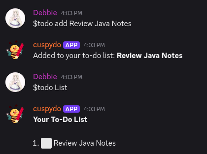
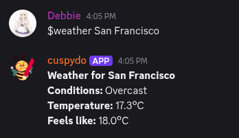

# Cuspydo 

Cuspydo is a Python Discord bot for managing personal to-do lists
and using everyday utilities directly within Discord.

## Why I Built It

I built Cuspydo after the task-management bots I used became
unreliable or were no longer maintained and hosted.

I wanted a personal task manager within Discord that I could
maintain, improve, and host myself, with features shaped around
my own needs.

## Features

- Personal to-do lists for individual users.
- Weather information.
- Timers and countdowns.
- Help information for available commands.

## Cuspydo in Action

### Personal To-Do Lists

Add a task and display your list directly in Discord.



### Weather Information

Request weather conditions for a location.



### A Simple Greeting

Use `$hello` to check that the bot responds.


## Built With

- Python
- Discord API

## Installation

### Requirements

- Python 3.12.3 (tested)
- Git
- A Discord bot token
- An internet connection

### Download the project

```bash
git clone https://github.com/DebbieSan/cuspydo.git
cd cuspydo
```

### Create a virtual environment

On Linux, macOS, or WSL:

```bash
python3 -m venv .venv
source .venv/bin/activate
```

On Windows PowerShell:

```powershell
py -m venv .venv
.\.venv\Scripts\Activate.ps1
```

### Install dependencies

With the virtual environment active:

```bash
python -m pip install -r requirements.txt
```

Configuration is required before starting the bot.

## Configuration

Cuspydo requires a Discord bot token stored in the
`CUSPYDO_TOKEN` environment variable.

Set it in the terminal where you will run the bot.

### Linux, macOS, or WSL

```bash
export CUSPYDO_TOKEN="YOUR_DISCORD_BOT_TOKEN"
```

### Windows PowerShell

```powershell
$env:CUSPYDO_TOKEN = "YOUR_DISCORD_BOT_TOKEN"
```

Replace the placeholder locally with your own bot token.
Never put your real token in this README or commit it to Git.

These commands set the variable for the current terminal session.

### Weather Service

Weather forecasts are provided by [Open-Meteo](https://open-meteo.com/).
The public forecast API requires no API key for non-commercial use.
An internet connection is required.

## Running the Bot

From the project folder, with your virtual environment active
and your token configured, run:

```bash
python cuspydo.py
```

Keep the terminal open while using the bot.
Press Ctrl+C to stop it.

## Usage

In a Discord server where Cuspydo is installed and running,
use these commands in a channel the bot can access:

| Command | Purpose |
|---|---|
| `$hello` | Get a greeting from the bot. |
| `$weather San Francisco` | Request weather information for London. |
| `$todo add Review Java notes` | Add a task to your personal to-do list. |
| `$todo list` | Display your personal to-do list. |

Replace `San Francisco` with your desired location and
`Review Java notes` with your own task.

## Deployment

Cuspydo is hosted on a DigitalOcean server.

